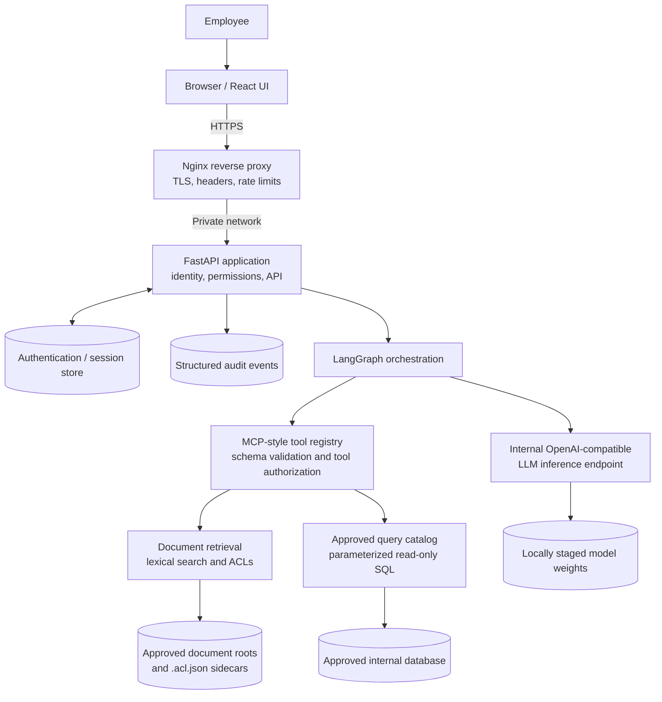
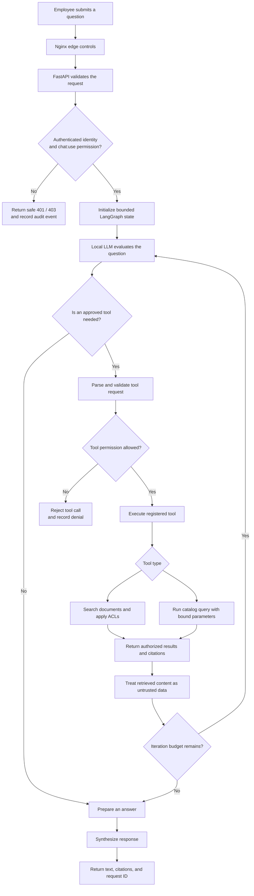

<div align="center">
  
  <h1>AeroGrid AI</h1>
  <p><strong>Connected intelligence. Clear direction.</strong></p>
  <p>A private enterprise AI assistant for searching organizational knowledge, querying approved internal data, and helping employees find trusted answers.</p>
  <p>
    <a href="https://www.python.org/"></a>
    <a href="https://fastapi.tiangolo.com/"></a>
    <a href="docs/ORCHESTRATION_MCP.md"></a>
    <a href="frontend/enterprise-intranet-ai-assistant1/package.json"></a>
    <a href="docs/DEPLOYMENT.md"></a>
  </p>
  <p>
    <a href="#overview">Overview</a> ·
    <a href="#architecture">Architecture</a> ·
    <a href="#request-flow">Request flow</a> ·
    <a href="#security-model">Security</a> ·
    <a href="#technology-stack">Tech stack</a> ·
    <a href="#local-development">Setup</a> ·
    <a href="#deployment-and-operations">Deployment</a>
  </p>
</div>

## Overview

AeroGrid AI is a self-hosted enterprise knowledge assistant designed to operate inside an organization's private network. Employees can ask questions in natural language, search authorized internal documents with citations, and access approved database information through controlled tools.

The backend is configured to use an internally hosted, OpenAI-compatible inference endpoint rather than requiring a public AI API. A bounded LangGraph workflow coordinates model inference and the internal tools.

### Core capabilities

| Capability | Description |
| --- | --- |
| **Conversational interface** | Chat experience with source citations, safe error states, request cancellation, and state reset. |
| **Document search** | Searches approved PDF, TXT, Markdown, and `.markdown` files and returns safe source citations. |
| **Approved data queries** | Executes reviewed, parameterized catalog queries instead of arbitrary model-generated SQL. |
| **Bounded orchestration** | Uses LangGraph to coordinate inference and schema-validated MCP-style tools. |
| **Permission-aware retrieval** | Applies verified identity, server-side permissions, and document ACL filters. |
| **Audit trail** | Records structured, privacy-conscious events with request correlation identifiers. |
| **Load protection** | Configurable inference concurrency, queue depth, wait time, timeout, and output budgets. |
| **Private deployment path** | Docker Compose, Nginx, internal networking, offline staging scripts, and operational runbooks. |

> [!IMPORTANT]
> Implemented code paths are not the same as production validation. The local staging configuration has passed reported live checks for Nginx HTTPS termination, HTTP-to-HTTPS redirect, session authentication, server-side RBAC, edge rate limiting, interactive Next.js frontend proxy integration, and real local model inference (bridged to host Ollama `qwen2.5:3b`). However, this bridged setup is distinct from the planned fully containerized, air-gapped vLLM deployment, corporate OIDC/SSO integration is cryptographically simulated rather than live-federated, and full production rollout still depends on organization-approved databases, document ACLs, and production sign-off. See the [staging runbook](docs/STAGING_RUNBOOK.md) for the current verification status.

## Architecture

### System architecture



### Component responsibilities

| Layer | Responsibility | Repository locations |
| --- | --- | --- |
| **Edge proxy** | TLS termination, HTTP-to-HTTPS redirect, security headers, rate limits, and proxying | [`deploy/nginx.conf`](deploy/nginx.conf), [`deploy/docker-compose.yml`](deploy/docker-compose.yml) |
| **Frontend** | Chat interface, citation display, errors, cancellation, and state reset | [`app/static/`](app/static/), [`frontend/`](frontend/) |
| **API and identity** | FastAPI routes, request validation, identity, permission checks, and health endpoints | [`app/main.py`](app/main.py), [`app/auth/`](app/auth/), [`app/security.py`](app/security.py), [`app/config.py`](app/config.py) |
| **Orchestration** | Bounded state graph, tool selection, tool results, and response synthesis | [`app/orchestration/graph.py`](app/orchestration/graph.py), [`app/orchestration/service.py`](app/orchestration/service.py) |
| **Tool boundary** | MCP-style schemas, tool registry, and independent tool permission checks | [`app/orchestration/mcp.py`](app/orchestration/mcp.py) |
| **Documents** | Approved-root discovery, extraction, chunking, lexical search, ACLs, and citations | [`app/documents/`](app/documents/) |
| **Database** | Reviewed query catalog, parameter validation, limits, timeouts, and auditing | [`app/db/`](app/db/) |
| **Inference** | Internal chat-completions client, timeout and concurrency controls, and metrics | [`app/llm/service.py`](app/llm/service.py) |
| **Operations** | Containers, offline staging, deployment and rollback procedures | [`deploy/`](deploy/), [`docs/`](docs/), [`scripts/`](scripts/), [`tests/`](tests/) |

## Request flow

Each request passes API authentication and permission checks before the assistant can use internal tools.



### Available tool contracts

| Tool | Purpose | Required permission | Restrictions |
| --- | --- | --- | --- |
| `search_documents` | Search internal document chunks | `documents:search` | Approved roots only; ACL filtering before content is returned; safe citation metadata. |
| `query_database` | Execute a reviewed catalog query | `database:read` | Static approved SELECT statements, validated parameters, result caps, and timeout controls; no raw SQL tool. |

MCP defines the internal tool contract; it is not an authentication boundary. Each tool independently checks the caller's server-side identity and required permission.

### Document retrieval flow


**Retrieval notes:**
- Ranking is lexical/token-based; embedding retrieval is documented as deferred.
- Each file requires an administrator-managed adjacent ACL file, for example `benefits.pdf.acl.json`.
- Missing or malformed ACL files deny retrieval.
- Citations expose safe metadata such as filename, document ID, and page, not absolute filesystem paths.

## Security model

Security is enforced by the API and tool services, not by frontend state or model instructions alone.

| Control | Design described in the repository |
| --- | --- |
| **Authentication** | Configurable local/OIDC modes. OIDC token verification supports RS256/ES256 and requires organization-provided issuer/JWKS details; cryptographic OIDC validation is simulated and passed in automated tests, while connection to a live corporate IdP and MFA remains unverified. |
| **Authorization** | Server-side `ROLE_PERMISSION_MAP`, deny-by-default behavior, and permission checks on protected endpoints and tools. |
| **Document ACLs** | Verified caller roles are checked against administrator-managed file ACLs before retrieval results reach the model. |
| **Database safety** | Reviewed catalog queries, parameter binding, result caps, and timeout controls. Production requires a least-privileged read-only database account. |
| **Prompt-injection boundaries** | Retrieved documents and database rows are treated as untrusted data and are not treated as executable instructions. |
| **Audit hygiene** | Structured request-correlated records are designed to omit tokens, passwords, raw prompts, and database credentials. |
| **Inference isolation** | Internal-only configured LLM endpoint, hostname allowlist, and private app-to-inference network. |
| **Capacity protection** | Process-local inference concurrency, bounded queue depth, queue wait timeout, and safe overload/unavailable responses. |
| **Container hardening** | Non-root application user, restricted network topology, read-only mounts for selected inputs, and no-new-privileges. |

> [!NOTE]
> These are repository-described controls, not a substitute for runtime verification. Corporate OIDC/SSO configuration, production permission mappings, database credentials and policies, model licensing and approval, TLS trust, audit retention, and staging evidence must be supplied or verified by the organization. The Python inference admission controller is process-local, not a cluster-wide queue.

## Technology stack

### Backend and orchestration

| Technology | Role |
| --- | --- |
| **Python 3.11–3.13** | Backend runtime |
| **FastAPI** | REST API and route handling |
| **Uvicorn** | ASGI server |
| **Pydantic Settings** | Validated environment-driven configuration |
| **LangGraph** | Bounded, stateful orchestration graph |
| **LangChain Core** | Core model/message abstractions |
| **Internal MCP-style tools** | Schema-validated document and database operations |
| **PyJWT with cryptography** | Signed-token verification support |
| **SQLAlchemy** | Database access and parameterized query execution |
| **PyMuPDF** | PDF text extraction |
| **httpx** | Calls the internal OpenAI-compatible inference endpoint |

### Frontend

| Technology | Role |
| --- | --- |
| **React 19** | UI components |
| **Next.js 16** | Modular frontend application and build |
| **TypeScript 5.7** | Typed UI and API contracts |
| **Tailwind CSS 4** | Styling |
| **Lucide React** | Icons |
| **react-markdown + remark-gfm** | Markdown rendering |
| **SWR** | Data-fetching support |
| **next-themes** | Theme support |

The repository contains both a FastAPI-served static UI in `app/static/` and a modular frontend under `frontend/enterprise-intranet-ai-assistant1/`. The served entry point depends on the runtime configuration. The current Compose file defines the FastAPI service and does not define a separate Next.js service.

### Runtime and operations

| Technology | Role |
| --- | --- |
| **Nginx** | Reverse proxy, TLS termination, headers, and rate limiting |
| **Docker Compose / Podman** | Single-host container orchestration |
| **vLLM-compatible service** | Documented internal model-serving path |
| **SQLite** | Local authentication/session and administrative audit persistence |
| **pytest / pytest-asyncio** | Unit, integration, and security tests |
| **Capacity benchmark harness** | Exercises inference admission and overload behavior |

The production database engine/driver and exact local model must be selected and approved by the organization. A candidate model label does not mean the model has passed license, security, or performance review.

## Local development

### Prerequisites

- Python 3.11–3.13
- Git
- An approved package source for the pinned dependencies in `pyproject.toml`
- Optional: Node.js and pnpm for the modular Next.js frontend
- An internally reachable OpenAI-compatible inference endpoint for model-backed chat

### Setup steps

1. **Clone the repository:**
   ```bash
   git clone https://github.com/NithinGJ2005/AeroGrid_AI.git
   cd AeroGrid_AI
   ```

2. **Create a virtual environment and install dependencies:**

   *Windows PowerShell:*
   ```powershell
   python -m venv .venv
   .\.venv\Scripts\Activate.ps1
   python -m pip install -e ".[dev]"
   ```

   *Linux / macOS:*
   ```bash
   python3 -m venv .venv
   source .venv/bin/activate
   python -m pip install -e ".[dev]"
   ```

   > For offline work, use the approved internal package source or staged wheelhouse. A normal pip install may require network access.

3. **Configure the environment:**

   *Windows PowerShell:*
   ```powershell
   Copy-Item .env.example .env
   ```

   *Linux / macOS:*
   ```bash
   cp .env.example .env
   ```

   Edit `.env` for the local environment. Replace example secrets with a fresh, non-production secret of at least 32 characters. Never commit `.env`, real credentials, tokens, private keys, production data, or model weights. Local development defaults are not production settings.

4. **Start the API:**
   ```powershell
   python -m uvicorn app.main:create_app --factory --host 127.0.0.1 --port 8000
   ```

   Open the following local endpoints:
   - Application: [http://127.0.0.1:8000/](http://127.0.0.1:8000/)
   - Liveness: [http://127.0.0.1:8000/health/live](http://127.0.0.1:8000/health/live)
   - Readiness: [http://127.0.0.1:8000/health/ready](http://127.0.0.1:8000/health/ready)
   - OpenAPI docs: [http://127.0.0.1:8000/docs](http://127.0.0.1:8000/docs) (when enabled by configuration)

5. **Run the modular frontend (optional):**

   *Development mode:*
   ```bash
   cd frontend/enterprise-intranet-ai-assistant1
   pnpm install
   pnpm dev
   ```

   *Production build against containerized staging backend:*
   ```powershell
   cd frontend/enterprise-intranet-ai-assistant1
   npm install
   npm run build
   $env:NODE_EXTRA_CA_CERTS = "D:\MultiAgent\deploy\certs\server.crt"
   .\node_modules\.bin\next.cmd start -p 3000
   ```
   > The production Next.js configuration proxies `/api/v1/:path*` to the Nginx TLS port (`https://127.0.0.1:443`). `NODE_EXTRA_CA_CERTS` is required so the Node.js reverse-proxy runtime trusts the internal staging CA certificate without disabling TLS validation.

## API overview

Available routes and behavior depend on the running configuration and caller permissions.

| Endpoint | Method | Purpose |
| --- | --- | --- |
| `/health/live` | `GET` | Liveness check |
| `/health/ready` | `GET` | Readiness/configuration check |
| `/api/v1/chat` | `POST` | Submit a question; requires `chat:use` |
| `/api/v1/mcp/tools` | `GET` | List MCP-style tool descriptors; requires `chat:use` |
| `/api/v1/mcp/tools/{tool_name}` | `POST` | Invoke a registered tool; tool-level authorization still applies |
| `/api/v1/admin/metrics` | `GET` | Inference counters and latency metrics; requires `admin:diagnostics` |
| `/api/v1/admin/users` | `GET` / `POST` | User administration; requires applicable user permissions |
| `/api/v1/admin/audit-events` | `GET` | Read administrative audit events; requires `audit:read` |

Use the running OpenAPI specification for exact request and response schemas. Do not expose the API outside the intended internal security boundary.

## Data and model integration

### Database integration

Configure `DATABASE_URL` only after the organization confirms the database engine, approved SQLAlchemy driver, network/TLS policy, read-only service account, schema, timeout policy, and reviewed query catalog.
- Only code-reviewed catalog query definitions should be callable.
- Query parameters must be validated and bound.
- The database account itself must be least-privileged and read-only.
- The sample catalog is synthetic; do not point it at production data without review.

See the [Database Integration Guide](docs/DATABASE_INTEGRATION.md).

### Document integration

Set `DOCUMENT_ROOTS` to administrator-approved internal directories. Place supported files and adjacent ACL sidecars such as:
```json
{
  "allowed_roles": ["employee"]
}
```

Use the actual organization role names, validate ACL ownership, and ensure missing or malformed ACLs deny retrieval. See the [Document Retrieval Guide](docs/DOCUMENT_RETRIEVAL.md).

### Local model integration

Configure `LLM_ENABLED`, `LLM_BASE_URL`, `LLM_ALLOWED_HOSTS`, and `LLM_MODEL` for the approved internal model-serving endpoint. Stage weights and tokenizer files locally; do not rely on startup-time downloads.
- The client calls an OpenAI-compatible `/chat/completions` endpoint.
- Output/context budgets, request timeout, concurrency, queue depth, and queue wait are configurable.
- Before production, record the model revision, license, quantization, tokenizer compatibility, hardware benchmark, and organizational approval.

See the [Local LLM Operations Guide](docs/LLM_OPERATIONS.md).

## Deployment and operations

The repository includes a deployment specification and staging runbook for a single-host private-network topology.

### Deployment pipeline


### Compose services

| Service | Purpose | Notes |
| --- | --- | --- |
| `reverse-proxy` | Nginx entry point on ports 80 and 443 | TLS certificate/key and `nginx.conf` mounted read-only. |
| `app` | FastAPI, authentication, orchestration, document and database tools | Application port is not published to the host; uses internal networks and persistent auth/audit volumes. |
| `llm-service` | Internal model inference | Model weights mounted read-only; GPU reservation is configured in Compose. |

### Key deployment files

- `deploy/Dockerfile` — application image build.
- [`deploy/docker-compose.yml`](deploy/docker-compose.yml) — services, mounts, networks, and runtime variables.
- [`deploy/nginx.conf`](deploy/nginx.conf) — TLS, proxying, security headers, and rate limiting.
- [`deploy/offline-staging.sh`](deploy/offline-staging.sh) and [`deploy/offline-staging.ps1`](deploy/offline-staging.ps1) — dependency staging helpers.
- [`deploy/verify_deployment_images.sh`](deploy/verify_deployment_images.sh) — image ID preflight and recording helper.
- [`docs/DEPLOYMENT.md`](docs/DEPLOYMENT.md) — deployment guidance and configuration requirements.
- [`docs/STAGING_RUNBOOK.md`](docs/STAGING_RUNBOOK.md) — staging validation, operations, and rollback procedures.

### Production readiness checklist

- [ ] Connect and federate with a live corporate OIDC/SAML IdP and MFA (OIDC token validation and RBAC mapping are verified via cryptographic simulation in `tests/security/test_oidc_simulation.py`, but live provider integration remains unverified).
- [ ] Configure the actual database driver, read-only credentials, reviewed query catalog, and native timeout policy.
- [ ] Provide approved document roots and administrator-managed ACL files.
- [ ] Approve the local model revision/license and provide scanned weights and tokenizer files.
- [ ] Install internal CA-signed TLS certificates and verify the trust chain.
- [ ] Generate a strong production secret and confirm secure cookie, CSRF, and allowed-origin behavior.
- [ ] Build/export images on a trusted workstation; record actual image identities and archive checksums there.
- [ ] Verify staging images against the separately trusted manifest. Never establish the trusted baseline solely by recording unverified images on staging.
- [ ] Validate Compose interpolation and Nginx syntax on the target runtime.
- [ ] Test HTTP-to-HTTPS redirect, TLS, security headers, actual rate limiting, login/session behavior, role/ACL isolation, and browser UI.
- [ ] Obtain operations/security/change-control sign-off and SSO/MFA sign-off where required.

A passing unit test or YAML parse is not proof of live TLS, GPU, container, or identity-provider behavior.

## Tests and benchmarks

Run the automated test suite:
```powershell
python -m pytest
```

Run security tests only:
```powershell
python -m pytest tests/security
```

Run unit and concurrency tests:
```powershell
python -m pytest tests/unit/test_concurrency_queue.py
```

Run the unit capacity admission harness (simulated inference):
```powershell
python scripts/benchmark_capacity.py --concurrency 8 --requests 40
```

Run the realistic end-to-end multi-tier employee workload benchmark (real model or live API):
```powershell
python scripts/benchmark_e2e_workload.py --tiers 1 10 25 50 75 100 --burst-levels 10 50 100 --output benchmark_production_results.json
```

The repository test suite consists of **172 automated tests passing on Windows** (`python -m pytest`) across unit, integration, security, RBAC authorization, simulated OIDC single sign-on, benchmark credential validation, and bounded async queue admission.

### Concurrency and capacity status
- **50 Concurrent Active Employees (30s Workload Submission / 56.8s Total Wall-Clock Drain)**: **Passed** for portal API latency targets against the live containerized staging stack (`https://127.0.0.1`) bridged to resident host Ollama `qwen2.5:3b` on an NVIDIA GeForce RTX 2050 (4GB VRAM, 8GB host RAM), recorded in [`benchmark_results_staging_50user.json`](benchmark_results_staging_50user.json):
  - **Execution Window**: 30-second active workload submission test, with 56.8 seconds total wall-clock duration including worker and in-flight GPU generation drain.
  - **Request Volume & Status Breakdown**: 869 total requests across all status categories — 692 successful (`200 OK`), 141 intentional RBAC denials (`403 Forbidden`), 35 admission-shed rejections (`429 Too Many Requests`), and 1 connection timeout during teardown drain (`status_code: 0`). Requests are not all described as successful: 1 client timeout occurred alongside 35 rate-limit rejections.
  - **Reported Throughput**: **15.3 req/s**. Note on measurement interval: throughput is calculated across the full execution span (56.8s total duration from the launch of the first request through the drain and completion of the final queued in-flight generation: $869 / 56.8\text{s} \approx 15.3\text{ req/s}$), rather than the 30-second workload submission window alone.
  - **Latency**: Non-LLM p95 **171.5 ms** (non-LLM p50: 17.5 ms, p99: 201.2 ms), well within the $\le 1,000$ ms and $\le 2,000$ ms SLA targets.
  - **Inference Stability & Errors**: 16 chat completions succeeded, 35 excess chat requests were cleanly shed with HTTP 429 during queue saturation, 0 server errors (`5xx`), and 1 client-side connection timeout (`status_code: 0`) during teardown drain.
  - **Production Qualification Status**: While this 30-second workload submission test verifies short-window queue stability, bounded concurrency enforcement, and admission limits, a long-duration 2–4 hour staging soak test remains pending for final production certification.
- **75 to 100 Concurrent Active Employees**:
  - **Local 100-User Benchmark**: **FAILED** against the 1,000 ms non-LLM p95 target for the measured run (non-LLM p95: 1,436.6 ms at 75 users; 2,020.2 ms at 100 users [1-worker baseline] and 1,774.5 ms [2-worker candidate], exceeding the $\le 1.0$s target). While process stability, security isolation, and overload shedding (HTTP 429) pass with zero crashes or leaks, portal API latency targets fail on local hardware.
  - **Target Docker Compose / Nginx Staging**: **UNVERIFIED** until directly benchmarked on staging infrastructure.
- **Simultaneous Chat Bursts**: Independently tested across 10, 50, and 100 simultaneous chat submissions. The system enforces strict bounded admission ($\text{active generations} + \text{queue depth} = 2 + 10 = 12$ across dual workers), immediately returning structured HTTP 429 (`service_overloaded`) to excess requests with zero timeouts or process deadlocks.
- **Runtime Separation**: Staging benchmarks were measured against host-bridged Ollama (`http://host.docker.internal:11434/v1`); fully containerized, air-gapped vLLM runtime performance remains pending live staging validation. Cloud GPU validation metrics on NVIDIA T4 hardware are documented in [`docs/COLAB_VALIDATION.md`](docs/COLAB_VALIDATION.md).

See the [Capacity and Benchmarks Guide](docs/BENCHMARKS.md), [Colab GPU Validation Guide](docs/COLAB_VALIDATION.md), and [Local LLM Operations Guide](docs/LLM_OPERATIONS.md).

## Repository structure

```text
AeroGrid_AI/
├── app/
│   ├── auth/                  # Identity, sessions, permissions, accounts
│   ├── db/                    # Query catalog and database access
│   ├── documents/             # File discovery, extraction, indexing, ACLs, citations
│   ├── llm/                   # Local inference client and capacity controls
│   ├── orchestration/         # LangGraph workflow and MCP-style tools
│   ├── static/                # FastAPI-served UI assets, including the logo
│   ├── audit.py               # Structured audit sink
│   ├── config.py              # Validated central configuration
│   ├── main.py                # FastAPI app factory and route setup
│   └── security.py            # Request security helpers
├── frontend/
│   └── enterprise-intranet-ai-assistant1/  # React / Next.js / TypeScript frontend
├── deploy/                    # Docker, Nginx, offline staging and image verification
├── docs/                      # Architecture, security, integration and runbooks
├── sample_docs/               # Sample documents with ACL sidecars
├── scripts/                   # Capacity benchmark utilities
├── tests/
│   ├── unit/
│   ├── integration/
│   └── security/
├── .env.example
├── pyproject.toml
├── LICENSE
└── README.md
```

## Documentation

| Document | Description |
| --- | --- |
| [Architecture](docs/ARCHITECTURE.md) | System components and target topology |
| [Security Controls](docs/SECURITY.md) | Authentication, authorization, and audit behavior |
| [Security Verification](docs/SECURITY_VERIFICATION.md) | Threat cases and automated test coverage |
| [Permission Matrix](docs/PERMISSION_MATRIX.md) | Roles and permissions reference |
| [Data Provenance](docs/DATA_PROVENANCE.md) | Data source and provenance notes |
| [Database Integration](docs/DATABASE_INTEGRATION.md) | Database onboarding and query restrictions |
| [Document Retrieval](docs/DOCUMENT_RETRIEVAL.md) | File processing, ranking, ACLs, and citations |
| [LLM Operations](docs/LLM_OPERATIONS.md) | Local inference, capacity and model review |
| [Orchestration and MCP](docs/ORCHESTRATION_MCP.md) | Graph workflow, tool contracts and trust boundaries |
| [Frontend and Accessibility](docs/FRONTEND.md) | UI behavior, keyboard interaction and citations |
| [Deployment](docs/DEPLOYMENT.md) | Containers, private networking, and offline staging |
| [Staging Runbook](docs/STAGING_RUNBOOK.md) | Verification gates, operating procedures and rollback |
| [Benchmarks](docs/BENCHMARKS.md) | Metrics and capacity-testing methodology |
| [Colab GPU Validation](docs/COLAB_VALIDATION.md) | Google Colab NVIDIA T4 GPU inference benchmarks and artifacts |
| [Implementation Plan](docs/IMPLEMENTATION_PLAN.md) | Phases and organization prerequisites |

## Contributing

1. Create a branch for your change.
2. Keep security-sensitive behavior covered by automated tests.
3. Do not commit secrets, private model weights, production data, session databases, or TLS private keys.
4. Update architecture/security/runbook documentation when behavior changes.
5. Run `python -m pytest` and include the actual result in your pull request.
6. Mark environment-dependent checks as pending until they have been executed against the intended runtime.

## License

See LICENSE.

<div align="center">
  <p><strong>AeroGrid AI</strong></p>
  <p>Connected intelligence. Clear direction.</p>
  <p>Built for private, permission-aware enterprise knowledge access.</p>
</div>
