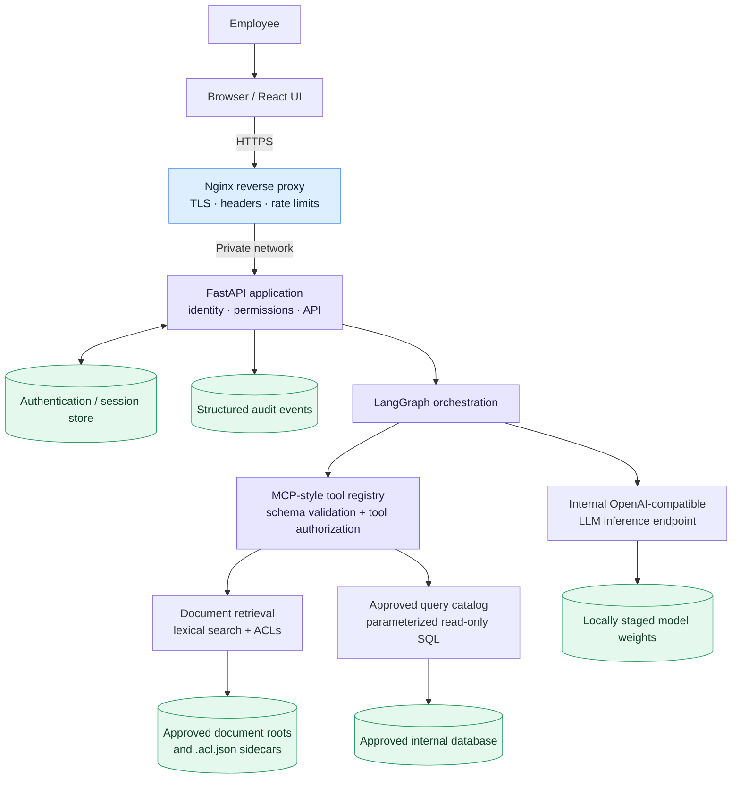
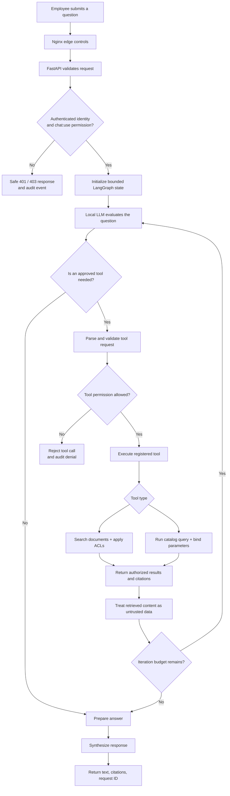
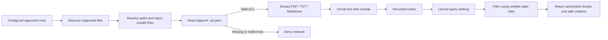
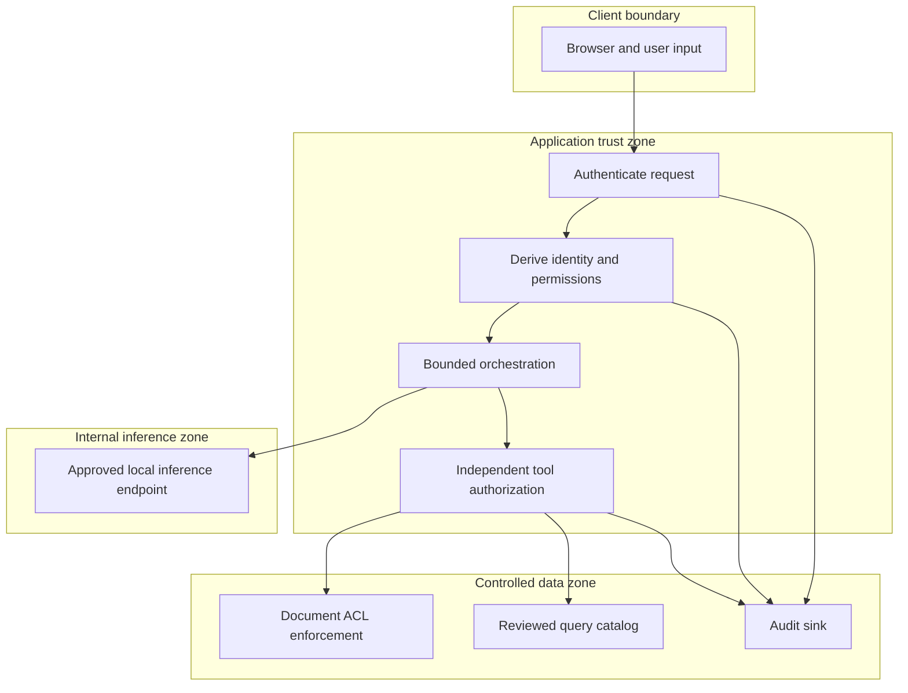
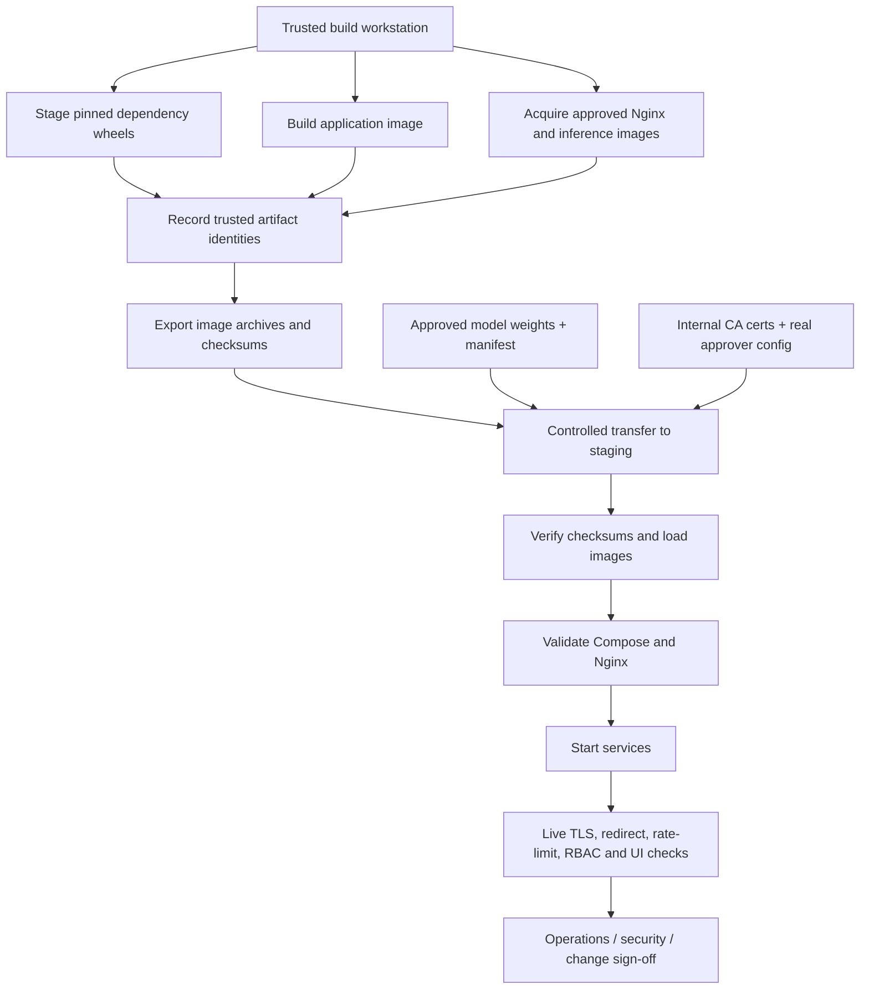

AeroGrid AI
Connected intelligence. Clear direction.
A private enterprise intranet AI assistant for searching organizational knowledge, querying approved internal data, and helping employees find trusted answers.

[!\[Python\]\(https://img.shields.io/badge/Python-3.11--3.13-3776AB?style=for-the-badge&logo=python&logoColor=white)](pyproject.toml)

[!\[LangGraph\]\(https://img.shields.io/badge/Orchestration-LangGraph-1C3C3C?style=for-the-badge)](docs/ORCHESTRATION_MCP.md)
[!\[React\]\(https://img.shields.io/badge/UI-React%2019-61DAFB?style=for-the-badge&logo=react&logoColor=black)](frontend/enterprise-intranet-ai-assistant1/package.json)
[!\[Private Deployment\]\(https://img.shields.io/badge/Deployment-Private%20Network-17324D?style=for-the-badge&logo=docker&logoColor=white)](docs/DEPLOYMENT.md)

Overview · Architecture · Request flow · Security · Tech stack · Setup · Deployment

Overview
AeroGrid AI is a self-hosted enterprise knowledge assistant designed for use inside an organization's private network. Employees can ask natural-language questions, search authorized internal documents with citations, and access approved database information through controlled tools.

The backend is configured to use an internally hosted, OpenAI-compatible inference endpoint, instead of requiring a public AI API. A bounded LangGraph workflow coordinates the internal tools and response generation.
Core capabilities
Capability	What it provides
Conversational UI	Chat experience with citations, safe error states, request cancellation, and state reset.
Document search	Searches approved PDF, TXT, Markdown, and .markdown files; returns safe source citations.
Approved data queries	Runs reviewed, parameterized catalog queries—not arbitrary model-generated SQL.
Bounded orchestration	Uses LangGraph to coordinate model inference and schema-validated MCP-style tools.
Permission-aware retrieval	Applies authenticated identity, server-side permissions, and document ACL filtering.
Audit trail	Records structured, privacy-conscious events with request correlation identifiers.
Load protection	Configurable inference concurrency, queue depth, wait time, timeout, and output budgets.
Private deployment path	Docker Compose, Nginx, internal networking, offline staging scripts, and runbooks.

[!IMPORTANT]
Code capability is not the same as production validation. A production deployment still depends on organization-specific identity configuration, a reviewed database query catalog and read-only credentials, real document ACLs, internal TLS certificates, approved model artifacts, trusted image manifests, and successful live staging checks. The repository's staging runbook marks the live Linux checks as pending.

Architecture
System architecture

Component responsibilities
Layer	Responsibility	Repository locations
Edge proxy	TLS termination, HTTP-to-HTTPS redirect, security headers, rate limits, proxying	deploy/nginx.conf, deploy/docker-compose.yml
Frontend	Chat interface, citation display, errors, cancellation, state reset	app/static/, frontend/
API and identity	FastAPI routes, request validation, identity, permission checks, health endpoints	app/main.py, app/auth/, app/security.py, app/config.py
Orchestration	Bounded state graph, tool selection, tool results, response synthesis	app/orchestration/graph.py, app/orchestration/service.py
Tool boundary	MCP-style schemas, tool registry, independent tool permissions	app/orchestration/mcp.py
Documents	Approved-root discovery, extraction, chunking, lexical search, ACLs, citations	app/documents/
Database	Reviewed query catalog, parameter validation, limits, timeouts	app/database/
Inference	Internal chat-completions client, timeout and concurrency controls, metrics	app/llm/service.py
Operations	Containers, offline staging, deployment and rollback procedures	deploy/, docs/, scripts/, tests/

Request flow
A request must pass API authentication and permission checks before internal tools can be used.

Available tool contracts
Tool	Purpose	Required permission	Restrictions
search_documents	Search internal document chunks	documents:search	Approved roots only; ACL filtering before content is returned; safe citation metadata.
query_database	Execute a reviewed catalog query	database:read	Static approved SELECT statements, validated parameters, result caps and timeout controls; no raw SQL tool.

MCP is not an authentication boundary. Each tool independently checks the caller's server-side identity and required permission.
Document retrieval flow

Retrieval notes
- Current ranking is lexical/token-based; embedding retrieval is documented as deferred.
- Each file requires an administrator-managed adjacent ACL, for example benefits.pdf.acl.json.
- Missing or malformed ACL files deny retrieval.
- Citations expose safe metadata such as filename, document ID, and page—not absolute filesystem paths.
Security model
Security is enforced by the API and tools, not by frontend state or model instructions alone.
Control	Design described in the repository
Authentication	Token verification and configurable local/OIDC modes. OIDC configuration supports RS256/ES256 and requires organization-provided issuer/JWKS details.
Authorization	Server-side ROLE_PERMISSION_MAP; deny-by-default behavior; protected endpoints and tools check permissions.
Document ACLs	Verified caller roles are checked against administrator-managed per-file ACLs before retrieval results reach the model.
Database safety	Reviewed catalog queries, parameter binding, result caps, timeout controls; production must use a least-privileged read-only database account.
Prompt-injection boundaries	Retrieved documents and database rows are treated as untrusted data, separated from system instructions, and not treated as executable commands.
Audit hygiene	Structured request-correlated records are designed to omit tokens, passwords, raw prompts, and database credentials.
Inference isolation	Internal-only configured LLM endpoint and hostname allowlist; app-to-inference traffic uses the private backend network.
Capacity protection	Process-local inference concurrency, bounded queue depth, queue wait timeout, and safe overload/unavailable responses.
Container hardening	Non-root application user, restricted network topology, read-only mounts for selected inputs, and no-new-privileges configuration.

[!NOTE]
These are the repository's intended controls, not a substitute for runtime verification. Corporate OIDC/SSO configuration, production permission mappings, database credentials and policies, model licensing and approval, TLS trust, audit retention, and staging evidence must be supplied or verified by the organization. The Python inference admission controller is process-local, not a cluster-wide queue.

Technology stack
Backend and orchestration
Technology	Role
Python 3.11–3.13	Backend runtime
FastAPI	REST API, route handling and request validation
Uvicorn	ASGI server
Pydantic Settings	Validated environment-driven configuration
LangGraph	Bounded, stateful orchestration graph
LangChain Core	Core model/message abstractions
MCP-style internal tools	Schema-validated document and database operations
PyJWT + cryptography	Signed-token verification support
SQLAlchemy	Database access and parameterized query execution
PyMuPDF	PDF text extraction
httpx	Calls to the internal OpenAI-compatible inference endpoint

Frontend
Technology	Role
React 19	UI components
Next.js 16	Modular frontend application/build
TypeScript 5.7	Typed UI and API contracts
Tailwind CSS 4	Styling
Lucide React	Icons
react-markdown + remark-gfm	Markdown rendering
SWR	Data-fetching support
next-themes	Theme support

The repository contains both a FastAPI-served static UI in app/static/ and a modular frontend under frontend/enterprise-intranet-ai-assistant1/. The actual served entry point depends on the selected runtime/configuration; Compose currently defines the FastAPI app and does not define a separate Next.js service.
Runtime and operations
Technology	Role
Nginx	Reverse proxy, TLS termination, headers and rate limiting
Docker Compose / compatible Podman setup	Container orchestration for a single host
vLLM-compatible inference service	Documented internal model-serving path
SQLite	Local authentication/session and administrative audit persistence
pytest / pytest-asyncio	Unit, integration and security tests
Capacity benchmark script	Exercises inference admission and overload behavior

The production database engine/driver and exact local model must be selected and approved by the organization. A candidate model label does not itself mean the model has passed license, security, or performance review.
Local development
Prerequisites
- Python 3.11–3.13
- Git
- An approved package source for the pinned dependencies in pyproject.toml
- Optional: Node.js and pnpm for the modular Next.js frontend
- An internally reachable OpenAI-compatible inference endpoint for model-backed chat
1. Clone the repository
git clone https://github.com/NithinGJ2005/AeroGrid_AI.git
cd AeroGrid_AI
2. Create a virtual environment and install dependencies
Windows PowerShell
python -m venv .venv
.venv\Scripts\Activate.ps1
python -m pip install -e ".[dev]"
Linux / macOS
python3 -m venv .venv
source .venv/bin/activate
python -m pip install -e ".[dev]"
For offline work, use the approved internal package source or staged wheelhouse; normal pip installation can require network access.
3. Configure environment
cp .env.example .env
On PowerShell:
Copy-Item .env.example .env
Edit .env for your local environment. Replace example secrets with a fresh, non-production secret of at least 32 characters. Never commit .env, real credentials, tokens, private keys, production data, or model weights. Local development defaults are not production settings.
4. Start the API
python -m uvicorn app.main:create_app --factory --host 127.0.0.1 --port 8000
Open:
- App: http://127.0.0.1:8000/
- Liveness: http://127.0.0.1:8000/health/live
- Readiness: http://127.0.0.1:8000/health/ready
- OpenAPI docs: http://127.0.0.1:8000/docs (when enabled by configuration)
The UI may start while model-backed chat is unavailable if the local inference client is not configured or reachable.
5. Run the modular frontend (optional)
cd frontend/enterprise-intranet-ai-assistant1
pnpm install
pnpm dev
The standalone frontend build and API URL/proxy settings should follow that package's configuration. The Docker Compose deployment does not define a separate Next.js service.
API overview
Available routes and behavior depend on configuration and caller permissions.
Endpoint	Method	Purpose
/health/live	GET	Liveness check
/health/ready	GET	Readiness/configuration check
/api/v1/chat	POST	Submit a question; requires chat:use
/api/v1/mcp/tools	GET	List MCP-style tool descriptors; requires chat:use
/api/v1/mcp/tools/{tool_name}	POST	Invoke a registered tool; tool-level authorization still applies
/api/v1/admin/metrics	GET	Inference counters/latency metrics; requires admin:diagnostics
/api/v1/admin/users	GET / POST	User administration; requires applicable user permissions
/api/v1/admin/audit-events	GET	Read administrative audit events; requires audit:read

Use the running OpenAPI specification for exact request and response schemas. Do not expose the API outside the intended internal security boundary.
Data and model integration
Database integration
Configure DATABASE_URL only after the organization confirms the database engine, approved SQLAlchemy driver, network/TLS policy, read-only service account, schema, timeout policy, and reviewed query catalog.
- Only code-reviewed catalog query definitions should be callable.
- Query parameters must be validated and bound.
- The database account itself must be least-privileged and read-only.
- The sample catalog is synthetic; do not point it at production data without review.
See [Database Integration Guide](docs/DATABASE_INTEGRATION.md).
Document integration
Set DOCUMENT_ROOTS to administrator-approved internal directories. Place supported files and adjacent ACL sidecars such as:
{
 "allowed_roles": ["employee"]
}
Use the actual organization role names, validate ACL ownership, and ensure missing/malformed ACLs deny retrieval. See [Document Retrieval Guide](docs/DOCUMENT_RETRIEVAL.md).
Local model integration
Configure LLM_ENABLED, LLM_BASE_URL, LLM_ALLOWED_HOSTS, and LLM_MODEL for the approved internal model-serving endpoint. Stage weights and tokenizer files locally; do not rely on startup-time downloads.
- The client calls an OpenAI-compatible /chat/completions endpoint.
- Output/context budgets, request timeout, concurrency, queue depth and queue wait are configurable.
- Before production, record the model revision, license, quantization, tokenizer compatibility, hardware benchmark, and organizational approval.
See [Local LLM Operations](docs/LLM_OPERATIONS.md).
Deployment and operations
The repository includes a deployment specification and staging runbook for a single-host private-network topology.
Deployment pipeline

Compose services
Service	Purpose	Notes
reverse-proxy	Nginx entry point on ports 80 and 443	TLS certificate/key and nginx.conf mounted read-only.
app	FastAPI, auth, orchestration, document and database tools	Application port not published to the host; uses internal networks and persistent auth/audit volumes.
llm-service	Internal model inference	Model weights mounted read-only; GPU reservation is configured in Compose.

Key deployment files
- deploy/Dockerfile — application image build
- deploy/docker-compose.yml — services, mounts, networks and runtime variables
- deploy/nginx.conf — TLS, proxying, security headers and rate limiting
- deploy/offline-staging.sh / deploy/offline-staging.ps1 — dependency staging helpers
- deploy/verify_deployment_images.sh — image ID preflight/recording helper
- docs/DEPLOYMENT.md — deployment guidance and configuration requirements
- docs/STAGING_RUNBOOK.md — staging validation, operations and rollback procedures
Production readiness checklist
- [ ] Configure real corporate OIDC/SSO parameters, audience, role/group claims and server-side permission map if required.
- [ ] Configure the actual database driver, read-only credentials, reviewed query catalog and native timeout policy.
- [ ] Provide approved document roots and administrator-managed ACL files.
- [ ] Approve the local model revision/license and provide scanned weights and tokenizer files.
- [ ] Install internal CA-signed TLS certificates and verify the trust chain.
- [ ] Generate a strong production secret and confirm secure cookie, CSRF and allowed-origin behavior.
- [ ] Build/export images on a trusted workstation; record real image identities and archive checksums there.
- [ ] Verify staging images against the separately trusted manifest. Never establish the trusted baseline solely by recording unverified images on staging.
- [ ] Validate Compose interpolation and Nginx syntax on the target runtime.
- [ ] Test HTTP-to-HTTPS redirect, TLS, security headers, actual rate limiting, login/session behavior, role/ACL isolation, and browser UI.
- [ ] Obtain operations/security/change-control sign-off and SSO/MFA sign-off where required.
A passing unit test or YAML parse is not proof of live TLS, GPU, container, or identity-provider behavior.
Tests and benchmarks
Run the automated test suite:
python -m pytest
Run security tests only:
python -m pytest tests/security
Run the capacity harness:
python scripts/benchmark_capacity.py --concurrency 8 --requests 40
The repository's runbook records a historical result of 144 tests passing on Windows/Python 3.12. Re-run tests against the exact commit you intend to deliver; a historical count is not proof of a different commit or environment.

The benchmark documentation describes simulated inference scenarios for normal admission and queue saturation. Simulated latency/throughput tests exercise admission behavior; they are not a real-GPU or real-model performance benchmark. Inference admission is process-local, so multi-worker or multi-host deployments need shared capacity controls at an internal gateway or broker.

See [Capacity and Benchmarks](docs/BENCHMARKS.md).
Repository structure
AeroGrid_AI/
├── app/
│ ├── auth/ # Identity, sessions, permissions and accounts
│ ├── database/ # Query catalog and database access layer
│ ├── documents/ # Discovery, extraction, indexing, ACLs and citations
│ ├── llm/ # Local inference client and capacity controls
│ ├── orchestration/ # LangGraph graph, service and MCP-style tools
│ ├── static/ # FastAPI-served web assets
│ ├── audit.py # Structured audit sink
│ ├── config.py # Central validated configuration
│ ├── main.py # FastAPI app factory and routes
│ └── security.py # Request security helpers
├── frontend/
│ └── enterprise-intranet-ai-assistant1/ # React / Next.js / TypeScript source
├── deploy/
│ ├── Dockerfile
│ ├── docker-compose.yml
│ ├── nginx.conf
│ ├── offline-staging.sh
│ └── verify_deployment_images.sh
├── docs/ # Architecture, integration guides and runbooks
├── scripts/ # Capacity benchmark utilities
├── sample_docs/ # Sample documents for local development
├── tests/
│ ├── unit/
│ ├── integration/
│ └── security/
├── .env.example
├── pyproject.toml
└── README.md
Documentation
Document	Description
[Architecture](docs/ARCHITECTURE.md)	Components and target topology
[Security Controls](docs/SECURITY.md)	Authentication, authorization and auditing
[Security Verification](docs/SECURITY_VERIFICATION.md)	Threat cases and automated test coverage
[Database Integration](docs/DATABASE_INTEGRATION.md)	Database onboarding and query-catalog restrictions
[Document Retrieval](docs/DOCUMENT_RETRIEVAL.md)	File processing, ranking, ACLs and citations
[LLM Operations](docs/LLM_OPERATIONS.md)	Local inference, capacity and model approval
[Orchestration & MCP](docs/ORCHESTRATION_MCP.md)	Graph workflow, tool contracts and trust boundaries
[Frontend & Accessibility](docs/FRONTEND.md)	UI behavior, keyboard interaction and citations
[Deployment](docs/DEPLOYMENT.md)	Containers, private networking and offline staging
[Staging Runbook](docs/STAGING_RUNBOOK.md)	Validation gates, operational procedure and rollback
[Benchmarks](docs/BENCHMARKS.md)	Metrics and capacity-testing methodology
[Implementation Plan](docs/IMPLEMENTATION_PLAN.md)	Phases and organization prerequisites

Contributing
1. Create a branch for your change.
2. Cover security-sensitive behavior with automated tests.
3. Never commit secrets, production data, session databases, private keys, or model weights.
4. Update relevant architecture/security/runbook documentation for behavior changes.
5. Run python -m pytest and report the actual results in your pull request.
6. Mark environment-dependent checks as pending until they are executed against the intended runtime.
License
See LICENSE.

AeroGrid AI
Connected intelligence. Clear direction.

Built for private, permission-aware enterprise knowledge access.

